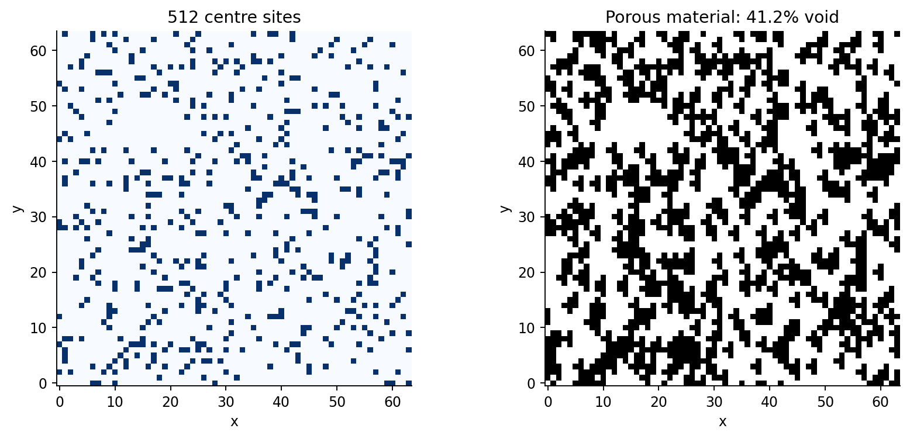
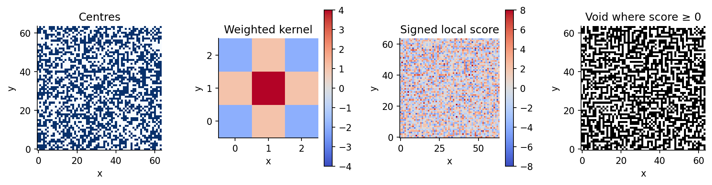

# How to make quantum cheese

A hands-on tutorial for building quantum geometry oracles with **PsiQuantum Construct**.

How can a short circuit describe a material with exponentially many microscopic features? Instead of listing every pore, we generate its geometry from a keyed permutation and a local rule. The circuit answers one question: **is this grid site inside a hole?**



## The construction

**Select centres → count covering centres → threshold → uncompute.**

The permutation selects exactly the requested number of centres. A stencil specifies the shape removed around each centre. For each queried site, the circuit accumulates contributions from the relevant centres, thresholds the count at one, and restores its coordinates and ancillary qubits.

## Run the tutorial

Use a supported Python environment following the [PsiQDK installation guide](https://docs.construct.psiquantum.com/psiqdk/installation.html). On Windows, use WSL.

```bash
python -m pip install psiqdk numpy pandas matplotlib ipykernel notebook
python -m notebook
```

Open [the notebook](QuantumCheeseConstructTutorial.ipynb), select that environment as its kernel, and run the cells in order. You need basic Python and quantum-gate notation; no cryptography or Construct experience is assumed.

The tutorial covers classical reference geometries, reusable circuit routines called **Qubricks**, small-instance simulation, circuit inspection, and resource comparisons. Optional viewers, resource sweeps, figure exports, and the larger circuit scan are enabled through switches near the top.

## Beyond fixed-shape holes

Integer weights turn the same accumulator into a local convolution. Positive and negative contributions produce richer textures. The notebook includes a classical example and a guided signed-circuit exercise.




Based on [*How to make quantum cheese*](https://arxiv.org/abs/2606.00222) by Alice Barthe. See also the [Construct documentation](https://docs.construct.psiquantum.com/).
